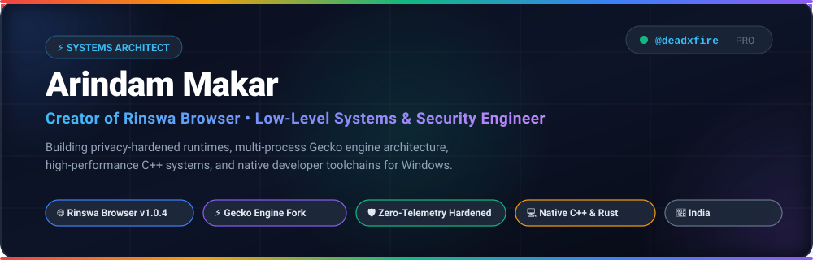

<div align="center">

<!-- Hero Banner -->


<br/><br/>

<!-- Dynamic Animated Typing SVG -->
<a href="https://github.com/deadxfire">
  
</a>

<br/>

<!-- Status Badges Row -->
<p align="center">
  
  
  
  
</p>

</div>

---

### 👨‍💻 About Me

I am a **Systems Architect & Low-Level Engineer** passionate about sovereign privacy, native browser runtime internals, and modern developer tooling. 

As the creator and lead engineer of **Rinswa Browser**, I architect and compile a privacy-hardened, zero-telemetry browser directly from the Mozilla Gecko engine, bundling native adblocking, cyber-glass aesthetics, and smart window management for Windows.

- 🔭 **Currently Building:** [Rinswa Browser v1.0.4 Stable](https://github.com/deadxfire/Rinswa-browser) — gecko-based standalone browser with 0 telemetry & Alpine Sunset glass UI.
- 🛡️ **Core Philosophy:** *Privacy is not a privilege or an add-on; it is an architectural requirement.*
- ⚡ **Engineering Focus:** Multi-process browser runtimes, native C++/Rust compilation pipelines, memory optimization, and developer ergonomics.
- 📍 **Based in:** Tarakeswar, West Bengal, India.

---

### 🚀 Featured Innovations & Projects

<table>
  <tr>
    <td width="50%" valign="top">
      <h3 align="left">🌐 <a href="https://github.com/deadxfire/Rinswa-browser">Rinswa Browser</a></h3>
      <p>A lightning-fast, privacy-hardened web browser built directly on modern multi-process Gecko.</p>
      <ul>
        <li><b>Zero Telemetry:</b> All Mozilla/Pocket pings severed at engine level.</li>
        <li><b>Native uBlock Origin:</b> Bundled directly into Gecko <code>policies.json</code>.</li>
        <li><b>Cyber-Glass UI:</b> Alpine Sunset wallpapers, custom themes & tab groups.</li>
        <li><b>Windows Native:</b> High-performance optimized 64-bit engine build.</li>
      </ul>
      <p>
        
        
        
        
      </p>
    </td>
    <td width="50%" valign="top">
      <h3 align="left">📖 <a href="https://github.com/deadxfire/Rinswa-Browser-Support">Rinswa Support & Docs</a></h3>
      <p>The official interactive support, diagnostics, documentation, and checksum hub for Rinswa Browser.</p>
      <ul>
        <li><b>Live Interactive Simulator:</b> Real-time browser UI sandbox in vanilla CSS.</li>
        <li><b>Cryptographic Verification:</b> Official SHA-256 release checksums.</li>
        <li><b>Hardware Troubleshooting:</b> WebGL, GPU acceleration & networking guides.</li>
        <li><b>Keyboard Shortcuts:</b> Complete power-user command reference.</li>
      </ul>
      <p>
        
        
        
      </p>
    </td>
  </tr>
  <tr>
    <td width="50%" valign="top">
      <h3 align="left">🛠️ <a href="https://github.com/deadxfire/DevForge-Local-Server-for-Developers">DevForge Local Server</a></h3>
      <p>Fast, isolated, portable, and powerful universal local web development environment for Windows developers.</p>
      <ul>
        <li>Zero registry bloat, completely standalone portable stack.</li>
        <li>Multi-version PHP, MySQL, Apache & SSL orchestration.</li>
        <li>One-click virtual hosts and dev routing.</li>
      </ul>
      <p>
        
        
        
      </p>
    </td>
    <td width="50%" valign="top">
      <h3 align="left">🔒 <a href="https://github.com/deadxfire/Laravel-Blade-Auth-Installer">Laravel Blade Auth</a></h3>
      <p>Production-ready, OWASP-hardened authentication scaffolding with Two-Factor Auth (TOTP) and 5 curated themes.</p>
      <ul>
        <li>OWASP Top 10 security standards & session hardening.</li>
        <li>Native TOTP 2FA, real-time metrics, user profile module.</li>
        <li>Zero-build setup supporting Laravel 11, 12 & 13.</li>
      </ul>
      <p>
        
        
        
      </p>
    </td>
  </tr>
</table>

---

### 🛠️ Technical Arsenal & Engineering Stack

<div align="center">

<table>
  <tr>
    <td align="center" width="20%"><b>Core Languages</b></td>
    <td>
      
      
      
      
      
      
      
      
    </td>
  </tr>
  <tr>
    <td align="center" width="20%"><b>Browser &amp; Systems</b></td>
    <td>
      
      
      
      
      
      
    </td>
  </tr>
  <tr>
    <td align="center" width="20%"><b>Security &amp; Privacy</b></td>
    <td>
      
      
      
      
      
    </td>
  </tr>
  <tr>
    <td align="center" width="20%"><b>Toolchains &amp; DevOps</b></td>
    <td>
      
      
      
      
      
    </td>
  </tr>
</table>

</div>

---

### 📊 Real-Time GitHub Analytics

<div align="center">

<table border="0">
  <tr>
    <td width="50%" align="center">
      
    </td>
    <td width="50%" align="center">
      
    </td>
  </tr>
</table>

<br/>

<a href="https://github.com/deadxfire">
  
</a>

</div>

---

### 📌 Architecture Highlights: What Powers Rinswa Browser?

```
                     ┌──────────────────────────────────────────────┐
                     │          RINSWA CYBER-GLASS SHELL            │
                     │  Tabs • Tab Groups • Omnibar • Themes (CSS) │
                     └──────────────────────┬───────────────────────┘
                                            │
                     ┌──────────────────────▼───────────────────────┐
                     │      NATIVE SECURITY & EXTENSION LAYER       │
                     │  uBlock Origin (policies.json) • No-Telemetry│
                     └──────────────────────┬───────────────────────┘
                                            │
                     ┌──────────────────────▼───────────────────────┐
                     │          GECKO ENGINE FORK (C++/RUST)        │
                     │  Multi-process e10s • SpiderMonkey • WebRender│
                     └──────────────────────┬───────────────────────┘
                                            │
                     ┌──────────────────────▼───────────────────────┐
                     │         WINDOWS 64-BIT RUNTIME (SEA)         │
                     │ DirectWrite • AudioIPC • Sandbox Token Drops │
                     └──────────────────────────────────────────────┘
```

---

### 🤝 Connect & Collaborate

I am always keen to collaborate on **browser engine architecture**, **systems programming**, **privacy innovations**, and **developer toolchains**.

<div align="center">

<a href="https://github.com/deadxfire">
  
</a>
&nbsp;
<a href="https://github.com/deadxfire/Rinswa-browser">
  
</a>
&nbsp;
<a href="https://github.com/deadxfire/Rinswa-Browser-Support">
  
</a>

<br/><br/>

<sub>Crafted with passion, precision, and privacy by <b>Arindam Makar (@deadxfire)</b>.</sub>

</div>
